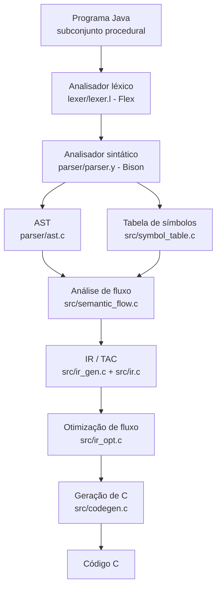

# Visão geral da arquitetura

O java2c é um compilador de etapas lineares escrito em C. Cada etapa tem um
arquivo ou par de arquivos claramente identificado, e a saída de uma etapa é a
entrada da seguinte.

## Responsabilidades

| Componente | Responsabilidade |
| --- | --- |
| `src/main.c` | Interpreta opções, abre a entrada, encadeia as etapas e controla o código de saída |
| `lexer/lexer.l` | Reconhece tokens, descarta comentários/espaços e reporta caracteres inválidos |
| `parser/parser.y` | Valida a gramática, monta a AST e dispara checagens de declaração e tipo |
| `parser/ast.{h,c}` | Define os nós da AST e fornece construtores, impressão e liberação |
| `src/symbol_table.{h,c}` | Mantém a pilha de escopos e os símbolos; verifica visibilidade e tipos |
| `src/semantic_flow.{h,c}` | Verifica retorno em todos os caminhos, alcance e inicialização |
| `src/const_eval.{h,c}` | Avalia expressões constantes usadas nas regras semânticas e na otimização |
| `src/ir.{h,c}` | Define as estruturas da representação intermediária e imprime a TAC |
| `src/ir_gen.{h,c}` | Traduz a AST validada para TAC, com nomes únicos por função |
| `src/ir_opt.{h,c}` | Aplica otimizações de fluxo sobre a TAC |
| `src/codegen.{h,c}` | Traduz a IR otimizada para código C |

## Fluxo de dados

1. **Léxico:** Flex converte o arquivo de entrada em tokens. Erros aqui são
  reportados como `ERRO LEXICO` e impedem as etapas seguintes.
2. **Sintaxe e AST:** Bison consome os tokens; as ações semânticas constroem a
   AST e chamam as rotinas da tabela de símbolos para declarar e consultar
   identificadores. Erros de gramática são reportados como `ERRO DE SINTAXE`.
3. **Semântica:** além das verificações feitas durante o parsing, uma análise
   posterior percorre a AST para aplicar regras de fluxo do Java. Erros são
   reportados como `ERRO SEMANTICO na linha N`.
4. **IR:** com a AST válida, `ir_gen` produz código de três endereços. Globais
   recebem valor inicial; funções listam parâmetros, locais e temporários.
   Nomes são tornados únicos para não colidirem com palavras reservadas de C.
5. **Otimização:** `ir_opt` simplifica o fluxo da TAC antes da geração final.
6. **Geração de C:** `codegen` produz o código C, que os scripts de teste
   compilam com GCC e executam.

Se qualquer etapa acusar erro, a geração de código não é realizada e o
processo termina com código de saída diferente de zero.

## Leituras relacionadas

- [Estrutura do repositório](structure.md) — onde cada arquivo está.
- [Fluxo de compilação](pipeline.md) — detalhes de cada etapa.
- [Tabela de símbolos](symbol-table.md) — escopos e verificações.
- [IR e geração de código](ir-and-codegen.md) — formato da TAC e modos de saída.
