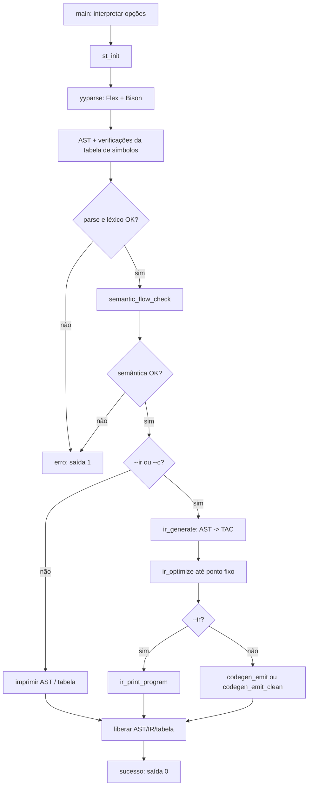

# Fluxo de compilação

Esta página detalha a sequência executada por `src/main.c`, desde a leitura das
opções até a liberação dos recursos. A visão geral dos componentes está em
[Visão geral](overview.md).

## 1. Entrada e opções

`main()` percorre `argv`, reconhece as opções descritas em
[Referência da CLI](../reference/cli.md) e guarda os caminhos de entrada e
saída. Se um arquivo de entrada for informado, ele é aberto em `yyin`; caso
contrário, o lexer usa a entrada padrão. A tabela de símbolos é inicializada
com `st_init()` antes do parsing.

## 2. Léxico e sintaxe

Flex fornece tokens a Bison por meio de `yylex()`. `%locations` e
`YY_USER_ACTION` associam cada token à sua linha. Erros léxicos são escritos em
stderr e ativam `had_lexical_error`; erros de gramática são reportados com
`ERRO DE SINTAXE na linha N`.

As ações semânticas da gramática:

- constroem a AST (`ast_root`) com os construtores de `parser/ast.c`;
- declaram e consultam símbolos com a API `st_*`;
- verificam tipos e visibilidade, emitindo `ERRO SEMANTICO` quando necessário;
- imprimem a tabela de símbolos ao final quando `--tabela`/`-t` foi usado.

## 3. Análise de fluxo

`semantic_flow_check(ast_root)` só é chamado se o parser terminou sem erro, não
houve erro léxico e existe uma AST. Ele percorre a árvore completa para aplicar
regras que dependem do programa inteiro:

- código inalcançável depois de `return`, `break` ou `continue`, e corpo de
  laço com condição constantemente falsa;
- retorno em todos os caminhos de métodos com retorno não-`void`;
- atribuição definitiva de variáveis locais antes da leitura, considerando
  condições constantes (`if (true) { x = 5; }` conta como atribuição).

A função retorna o número de erros; `main()` marca `had_semantic_error` quando
o retorno é positivo.

## 4. Representação intermediária

A IR só é construída quando a análise foi bem-sucedida **e** o usuário pediu
`--ir` ou um dos modos de geração de C. `ir_generate()`:

1. coleta funções e campos `static` (globais);
2. gera a IR de cada método e do bloco de comandos soltos, que vira `main`;
3. coloca inicializadores não constantes de globais em `__init_globals` quando
   não há `main` para recebê-los;
4. chama `ir_optimize()` antes de retornar.

O gerador consulta a tabela de símbolos (por isso ela precisa estar ativa) para
descobrir, por exemplo, o tipo de retorno de uma chamada e evitar criar um
temporário para funções `void`.

## 5. Otimização

`ir_optimize()` trabalha em lugar e repete suas transformações até um ponto
fixo. Cada iteração:

- monta um grafo de fluxo de controle por função;
- propaga e reescreve constantes;
- remove blocos inalcançáveis;
- limpa saltos e rótulos redundantes;
- aplica eliminação local de subexpressões comuns;
- remove e compacta temporários.

As rotinas são testadas isoladamente por `tests/ir_opt_test.c` (`make
test-ir-opt`).

## 6. Saída

| Modo | Função chamada | Destino |
| --- | --- | --- |
| padrão / `--tabela` | `print_ast`, `st_print` | stdout, com mensagens do modo não-quiet |
| `--ast` | `print_ast` com `@linha` | stdout |
| `--ir` | `ir_print_program` | stdout |
| `--c` | `codegen_emit` | stdout ou `-o` |
| `--c-clean` | `codegen_emit_clean` | stdout ou `-o` |

`--ast`, `--ir` e os modos C ativam o modo "quiet", que suprime o banner e as
mensagens de início/fim do modo padrão. Um erro ao abrir o arquivo de saída ou
um retorno `-1` do gerador de C também leva ao código `1`.

## 7. Limpeza

Ao final, `main()` libera a IR (`ir_program_free`), a AST (`free_ast`), fecha o
arquivo de entrada, chama `yylex_destroy()` e `st_free()`. O valor de retorno é
`0` somente se a análise e a geração solicitada terminaram sem erro.
